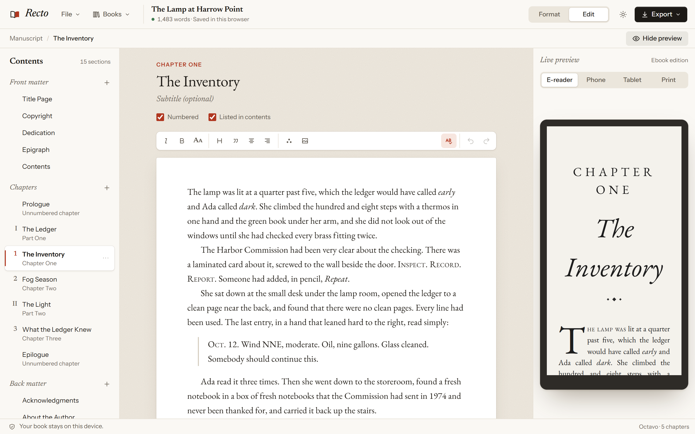
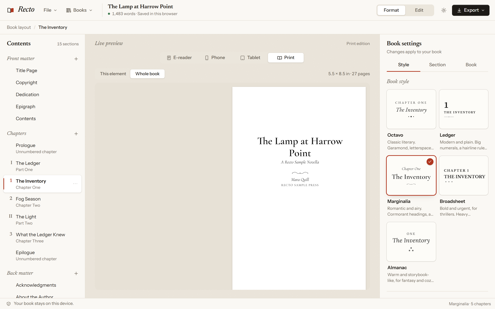
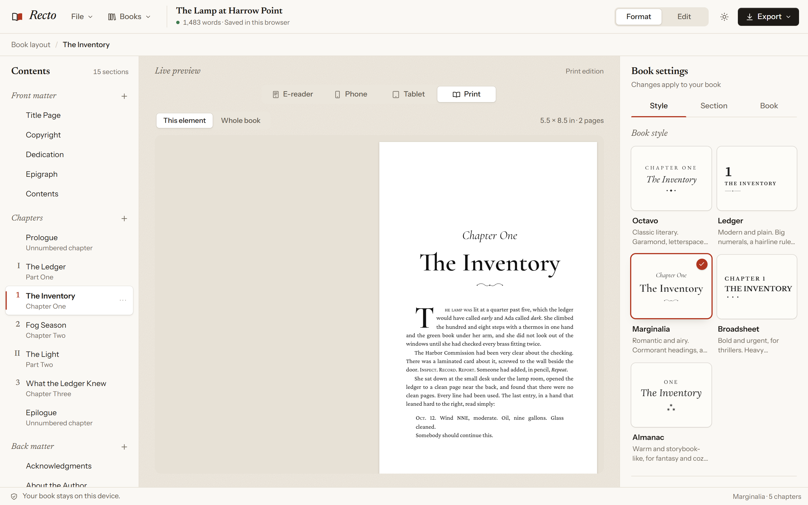
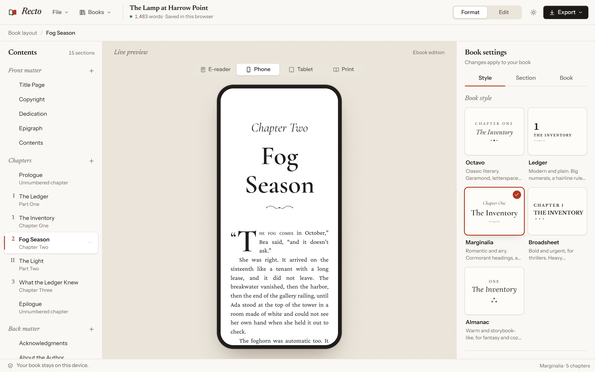
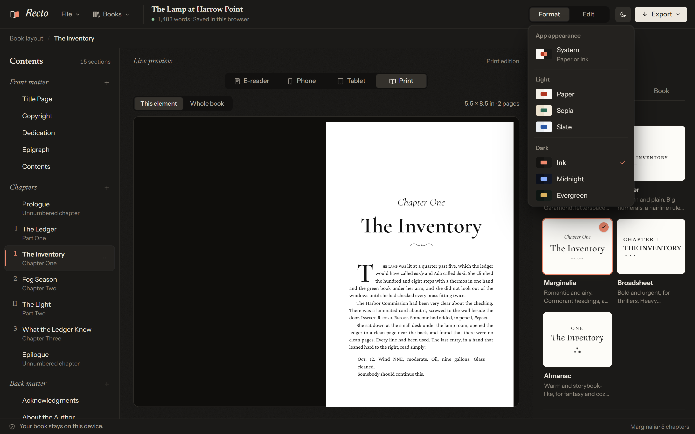
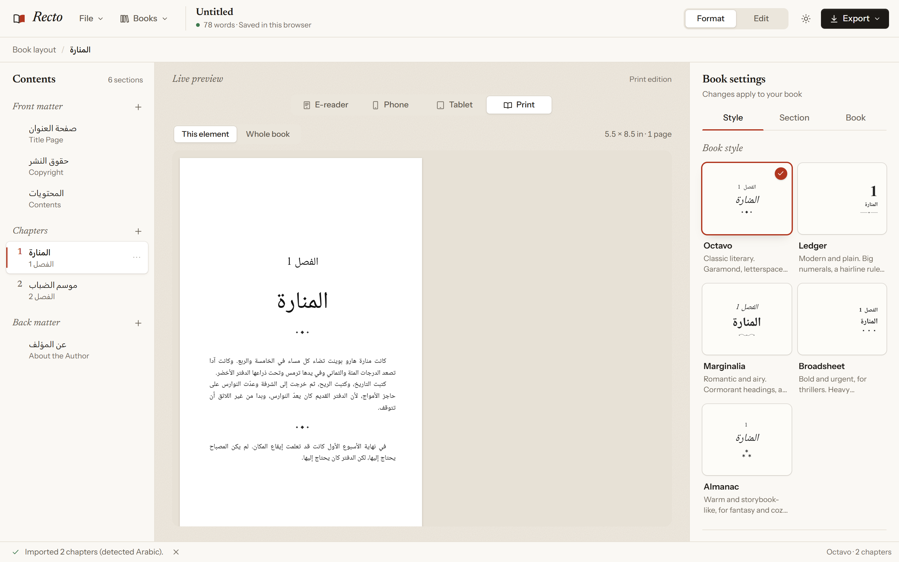

# Recto

**A free, open-source book formatter.** Write or import a manuscript in any language, pick a style, and export a store-ready **EPUB** and a print-ready **PDF** for paperbacks.

It runs in your browser with no account and no server, or as a desktop app for Windows, macOS and Linux.



Self-publishing authors usually format books with a dedicated app. The best-known one costs about $250 and only runs on a Mac. Recto does the same job, the dull, exacting part, for free on any computer:

- each chapter opens on a right-hand page, with a blank left-hand page added when needed
- the inside margin grows with the page count, the way KDP requires
- running heads, page numbers, footnotes and drop caps are handled for you
- the EPUB passes EPUBCheck and carries the accessibility metadata stores now ask for
- a preflight check catches what KDP and IngramSpark reject before you upload

> *Recto* is the printer's word for a right-hand page, which is where chapters begin.

## Features

- **Import a manuscript.** Word (`.docx`), Markdown, plain text or HTML.
  - Chapters split at *Heading 1* or at chapter lines in 30 languages ("Chapter 7", "Capítulo 7", "7. luku", "第七章", "الفصل ٣"…).
  - Parts, prologues, epilogues and back matter are recognized.
  - `* * *`, `#` and `⁂` lines become scene breaks.
  - Italics, bold, small caps, lists, tables and footnotes carry over.
- **Edit.** A distraction-free manuscript editor with the formatting books use:
  - italic, bold, small caps, block quotes, alignment and subheadings
  - footnotes, edited in place
  - bulleted and numbered lists, verse with hanging indents, callout boxes (note, tip, warning) and tables
  - text-message bubbles, scene breaks and store-link buttons
  - images inline, on a page of their own, full bleed to the page edges, or across a two-page spread, with captions and descriptions
- **Organize.** Front matter, parts and chapters, and back matter. Drag to reorder.
  - Chapters are numbered automatically ("Chapter One", "1", "Chapter 1"…).
  - Heading images above chapter titles.
  - Any section can be ebook-only or print-only, such as a newsletter page or an order form.
- **Box sets.** **Books → New box set** gathers books into one, each as a volume with its own opening page.
  - Chapter numbers start again in each volume, and the contents nest by volume.
  - Running heads name the volume, and its author when the volumes have different authors.
  - Each volume stays linked to its book, so you can bring in later edits.
- **Five book styles, and a style builder.** Original designs with OFL fonts and drawn ornaments:

  | Style | Look |
  | --- | --- |
  | **Octavo** | Classic literary |
  | **Ledger** | Modern and plain |
  | **Marginalia** | Romantic and airy |
  | **Broadsheet** | Bold, for thrillers |
  | **Almanac** | Storybook, for fantasy |

  **Customize** changes any of them: fonts, chapter numbers, heading alignment, title case and size, ornaments, paragraph spacing, line spacing, and advanced CSS. The CSS is filtered so nothing can load from outside the book. **Save style** shares the result as a `.recto-style` pack; [style-packs/](style-packs/) has some to start from.
- **Live previews.**
  - The ebook on an e-reader, a phone and a tablet.
  - Real paginated print spreads at the actual trim size, for one chapter or the whole book.
- **EPUB 3 export.**
  - Accessibility metadata (EPUB Accessibility 1.1) worked out from the book itself, DPUB-ARIA roles, and pop-up footnotes.
  - **EPUB for each store**: one file per retailer, each with only its own store links, since some stores reject books that link to a competitor.
  - Optional print page numbers in the ebook (a page list, which Kindle shows as real page numbers).
  - Vertical text for Japanese and Chinese, with upright numbers.
  - An EPUB 2 NCX fallback for older readers, a nested table of contents, landmarks, the cover and optional embedded fonts.
  - Size and KDP delivery-fee estimate at export.
- **Print-ready PDF.**
  - 20 trim sizes for paperback and hardcover, KDP and IngramSpark, in inches or millimetres, plus a large-print edition.
  - Mirrored margins with KDP's gutter minimums, and optional bleed.
  - Running heads, page numbers from chapter one, and none on openers or blank pages.
  - Footnotes at the foot of the page, or notes at the end of each chapter or the book.
  - No single stranded lines at page breaks (Recto's own widow and orphan handling).
  - A contents page with real page numbers. Pure black text, no link annotations, and a TrimBox and BleedBox printers read.
  - **PDF/X-1a** for IngramSpark in the desktop app, when Ghostscript is installed (PDF/X-3 with Ghostscript older than 10.05).
  - A separate **PDF for reading**, with live links and bookmarks, for selling direct.
- **Covers.** A store cover JPEG at KDP's ideal size, and the paperback wrap worked out from page count and paper: spine width, safe zones, barcode box, a template to design on, and a cover PDF.
- **Word export.** A `.docx` at the trim size, with footnotes, for an editor or for KDP's Word upload.
- **Preflight.** **Publish → Check the whole book** runs what stores and printers check on upload:
  - page count, blank pages, image resolution after layout, ISBNs, placeholder text, cover size
  - EPUBCheck (via epubcheck-ts) on the built file
  - names spelled two ways ("Josias" once, "Josiah" seven times)
- **Any language.** Write in English, Spanish, Russian, Greek, Arabic, Hebrew, Hindi, Thai, Chinese, Japanese, Korean or any other language with a BCP 47 code.
  - Import detects the manuscript's language and text encoding (UTF-8, UTF-16 and legacy code pages such as Windows-1251 or Shift_JIS). Both can be overridden.
  - Chapter labels, "Contents", the copyright page and the EPUB navigation come out in the book's language, with the right digits ("Capítulo 2", "Глава 2", "第二章").
  - Right-to-left books (Arabic, Hebrew, Persian, Urdu…) get right-to-left EPUB page progression, mirrored print gutters and spreads.
  - Scripts get appropriate typography: bundled Noto fonts for Arabic, Hebrew, Devanagari and Thai; extra subsets of the book fonts for Latin Extended, Cyrillic, Greek and Vietnamese; no letterspacing or drop caps where they'd break a script; full-width indents for CJK.
  - Print text is hyphenated with the TeX hyphenation patterns for 36 languages, so justified pages don't gape.
- **Spellcheck.** The editor checks spelling in the book's language.
  - In the desktop app, Recto picks the dictionary, and right-click offers suggestions and "Add to Dictionary".
  - In a browser, spellcheck uses the browser's own languages.
- **Desktop app for Windows, macOS and Linux.**
  - Opens `.recto` files when you double-click them, and saves them back in place. Before overwriting a file that changed elsewhere (a synced folder, another computer), it asks.
  - Exports PDFs straight to a file.
  - **Preview in Kindle Previewer**, when Amazon's Kindle Previewer is installed.
  - **Help → Check for Updates**, only when you ask.
- **Your files stay yours.**
  - Autosaves to your browser's (or the desktop app's) storage.
  - `.recto` files are plain JSON.
- **Interface in English, German, Spanish and French.** Choose under **Appearance → Interface language**; it follows your system language at first. [docs/translating.md](docs/translating.md) explains how to add another.
- **Dark mode and app themes.** The interface is styled like a typesetter's desk: warm paper, ink-black type, and a single accent color per theme.
  - Three light themes: Paper (rubric red), Sepia (bookcloth green), Slate (blue-black).
  - Three dark themes: Ink (vermilion), Midnight (pale blue), Evergreen (brass).
  - Or **System**, which follows your OS's light/dark setting.
  - App themes change the editor around the book, never the book itself.
  - Every theme meets WCAG AA contrast for text.

| Print spreads | Book styles | Phone preview |
| --- | --- | --- |
|  |  |  |





## Quick start

### Desktop app

Download the app for your system from the [latest release](https://github.com/fsiuhgshiqoih32/recto/releases/latest):

| System | File |
| --- | --- |
| Windows 10 and 11 | `Recto-Setup-x.y.z.exe` |
| macOS, Apple Silicon | `Recto-x.y.z-mac-arm64.dmg` |
| macOS, Intel | `Recto-x.y.z-mac-x64.dmg` |
| Linux | `Recto-x.y.z-linux-x86_64.AppImage`, or the `.deb` for Debian and Ubuntu |

The apps aren't signed by Microsoft or Apple yet (that takes paid certificates), so each system warns once:

- **Windows:** SmartScreen may say it "protected your PC". Choose **More info → Run anyway**.
- **macOS:** after the first launch is blocked, open **System Settings → Privacy & Security** and choose **Open Anyway**.
- **Linux:** make the AppImage executable (`chmod +x`). On Ubuntu 24.04 and later, install the `.deb` or start the AppImage with `--no-sandbox`.

A Microsoft Store listing avoids the Windows warning. [docs/microsoft-store.md](docs/microsoft-store.md) explains how to publish one, which is free.

To build the app yourself (it lands in `release/`):

```bash
npm install
npm run dist        # for the system you're on
```

### In the browser

```bash
git clone https://github.com/fsiuhgshiqoih32/recto.git
cd recto
npm install
npm run dev
```

Open http://localhost:5173. The sample novella *The Lamp at Harrow Point* loads on first run. Use **Books → New blank book** or **File → Import manuscript** to start your own. The app opens in **Format**; switch to **Edit** to work on the text. **File → Save a copy** downloads a `.recto` backup (the desktop app saves in place).

### Making the print PDF

In the desktop app, **Export → Export PDF** (Ctrl+P) lays out the book and saves the PDF straight to a file. In a browser:

1. Choose **Export → Print PDF**. Recto lays out every page.
   - If the real page count lands in a different KDP gutter tier than its estimate, it lays the book out a second time.
2. In the print dialog that opens, choose **Save as PDF**.
   - Page size and margins come from the book, so leave the dialog's own margins at their default.
   - Chrome and Edge give the most faithful results.

Or skip the browser and render from the command line. This uses your installed Chrome or Edge:

```bash
npm run pdf -- my-book.recto -o my-book.pdf
npm run pdf -- my-book.recto --reading   # a PDF for reading, with links and bookmarks
npm run pdf -- my-book.recto --pdfx      # PDF/X-1a, through an installed Ghostscript
npm run pdf -- --sample                  # the sample novella
```

### Making the EPUB

Choose **Export → Export EPUB**, or **EPUB for each store** if the book has store links. Upload the file to KDP, Apple Books, Kobo, Google Play Books or a distributor. **Publish → Check the whole book** runs EPUBCheck on it first.

From the command line:

```bash
npm run epub -- my-book.recto -o my-book.epub
npm run epub -- my-book.recto --page-numbers   # with the print edition's page numbers
```

The cover image (Book tab) is the ebook cover. For the paperback, the **Covers** section of the **Publish** tab works out the wraparound cover's size and spine, and makes a template and a cover PDF.

### Manuscript tips for a clean import

- Put each chapter title in **Heading 1**, or on its own line as `Chapter 7` or `Chapter 7: The Storm` (or the same in your language: `Capítulo 7`, `Глава 7`, `第七章`…).
- `Part One: …`, `Prologue`, `Epilogue`, `Acknowledgments` and `About the Author` are recognized too.
- Mark scene breaks with a line containing only `* * *`, `***`, `#` or `⁂`.

## How it works

```
manuscript (.docx / .md / .txt) ──► HTML ──► split into elements ──► TipTap JSON (the Book model)
                                                                          │
                                         src/render/html.ts  ◄────────────┘
                                         one renderer, semantic XHTML
                                          │                    │
                       EPUB: XHTML files + OPF/NCX/nav     Print: CSS Paged Media
                       (src/export/epub, JSZip)            laid out by paged.js
                                                           (src/export/print)
```

The key design decision is a single renderer. The ebook, the print PDF and every preview are made from the same XHTML, and each style is just CSS. That keeps the EPUB and the paperback from drifting apart.

| Path | What's there |
| --- | --- |
| `src/model/` | The `Book` type, defaults, box sets, chapter numbering, the CC0 sample novella |
| `src/import/` | `.docx` / Markdown / text import, chapter, scene-break and footnote detection |
| `src/render/` | Book → XHTML, the ebook stylesheet |
| `src/themes/` | The five styles, the style builder and its CSS filter, style packs, fonts, ornaments |
| `src/export/epub/` | OPF, nav, NCX, accessibility metadata, page list, vertical text, per-store editions and zip packaging |
| `src/export/print/` | Trim sizes, KDP gutter table, `@page` rules, the paged.js document, widow handling, PDF finishing, PDF/X |
| `src/export/cover/`, `src/export/docx/` | Paperback wrap covers; Word export |
| `src/preflight/` | The checks stores and printers apply on upload |
| `src/i18n/`, `locales/` | Language table and book words in 30 languages, chapter labels, language and encoding detection, hyphenation; the interface translations |
| `electron/` | The desktop shell: app:// origin, PDF export, save in place, updates, Kindle Previewer, spellcheck, file associations |
| `src/ui/`, `src/editor/`, `src/preview/` | The React app. App themes are token blocks at the top of `src/ui/app.css`, listed in `src/ui/appearance.ts` |
| `cli/` | Headless PDF and EPUB export (Playwright) |
| `style-packs/` | Shareable style packs, and how to submit one |

## Development

| Command | Does |
| --- | --- |
| `npm run dev` | Dev server |
| `npm run build` | Type-check and build the static site into `dist/` |
| `npm test` | Unit tests (Vitest): renderer, importers, EPUB structure, print rules, box sets, styles, preflight |
| `npm run test:e2e` | Browser tests (Playwright) against the production build |
| `npm run test:pdf` | Renders sample books to PDF and checks them (see below) |
| `npm run test:epub` | Builds sample EPUBs and validates them with epubcheck-ts |
| `npm run i18n` | Refreshes `locales/en.json` from the interface text in the code |
| `npm run pdf -- <file.recto>` | Command-line PDF export |
| `npm run epub -- <file.recto>` | Command-line EPUB export |
| `npm run sample:docx` | Regenerates `samples/` from the sample novella |
| `npm run screenshots` | Regenerates the README screenshots from a running dev server |
| `npm run desktop` | Builds and runs the desktop app |
| `npm run dist` | Builds the installers for the current OS into `release/` |
| `npm run dist:store` | Builds the Microsoft Store package (see [docs/microsoft-store.md](docs/microsoft-store.md)) |
| `npm run test:desktop` | Drives the Electron app with Playwright. Set `RECTO_APP=release/win-unpacked/Recto.exe` to test the packaged build |

`npm run test:pdf` checks that:

- every page is exactly the trim size
- every chapter opens on a right-hand page
- openers carry no running head or page number
- running heads and folios are correct on every other page
- the contents page numbers match where chapters really start
- body text is hyphenated
- no paragraph leaves a single line behind at a page break
- text is pure black and the PDF has no link annotations
- small books in Spanish, Russian, Arabic, Japanese and Hindi typeset in their own scripts, with localized labels, right-hand openers and the right fonts embedded
- footnotes land at the foot of the page that cites them, and bleed pages carry the right TrimBox
- box sets open each volume on a right-hand page with its own running heads
- with Ghostscript installed, the PDF/X file is PDF 1.3 with grey colour and an output intent

CI also validates the sample EPUBs with the official EPUBCheck and checks their accessibility with DAISY Ace.

The end-to-end tests and the PDF tools use an installed Chrome by default. Set `RECTO_BROWSER=msedge` or `RECTO_BROWSER=chromium` to change that. The latter needs `npx playwright install chromium` first.

CI runs everything on each push. Two more workflows handle publishing:

- One publishes the web app to GitHub Pages when enabled. Set **Pages → Source** to **GitHub Actions**, then add the Actions repository variable **ENABLE_GITHUB_PAGES** with the value **true**.
- One builds the Windows, macOS and Linux installers for every `v*` tag and attaches them to a GitHub release.

## Privacy

Recto sends nothing anywhere. There is no account, no telemetry and no server. Books stay in your browser's storage or the desktop app's, and in the files you save. The only time Recto goes online is when you choose **Help → Check for Updates**, which asks GitHub for the latest release.

## Limitations and roadmap

Not yet supported:

- fixed-layout EPUBs for picture books. Fixed layout can't meet the European Accessibility Act's text-adjustment requirements, and full-colour picture books need CMYK printing, below.
- vertical text in print. The ebook can be vertical; paged.js lays print pages out horizontally only.
- CMYK colour for colour interiors without Ghostscript. Chromium writes every colour as RGB, so PDF/X depends on a Ghostscript you install yourself (it's AGPL, so Recto doesn't bundle it).

Known gaps:

- Word paragraph alignment isn't imported (headings and scene breaks are).
- Chinese, Japanese and Korean use your computer's serif font (CJK fonts are too large to bundle). For the best print results, install Noto Serif CJK.
- The desktop spellchecker has dictionaries for most European languages plus Hebrew, Persian, Hindi, Korean and Vietnamese, but not Arabic, Chinese, Japanese or Thai. The Book panel says when a language has none.
- Recto has localized book words for 30 languages. Other languages typeset correctly, but you rename default headings like "Contents" yourself.
- The installers aren't code-signed (see Quick start). Notarizing for macOS needs a paid Apple Developer account, and signing for Windows a certificate or the free Store route.

Contributions are welcome. Please open an issue first for anything large.

## Clean-room statement

Recto is an independent project. It was written from scratch from publicly described features and general book-design practice. It contains no code, artwork, style designs or names from any commercial book formatter. All trademarks belong to their respective owners, and Recto is not affiliated with or endorsed by any of them.

## License

- Code: [MIT](LICENSE).
- Fonts: SIL Open Font License.
- Sample novella: CC0.

See [NOTICE.md](NOTICE.md) for details.
